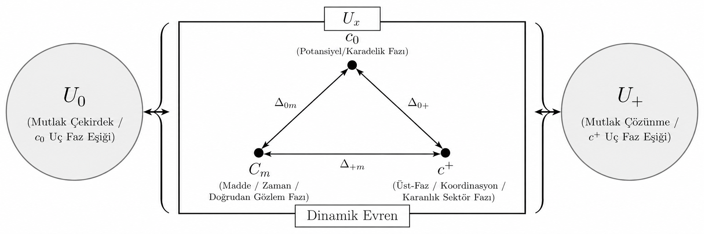

  

# Evertophy — Çekirdek Ontoloji

[🇬🇧 English](README.md) | [🇹🇷 Türkçe](README_TURKISH.md)

## Bilimin Kopuk Parçaları Arasında Ortak Bir Dil Arayışı

Modern bilim, insanlığın bugüne dek kurduğu en güvenilir bilgi yapısıdır. Deneyle sınanmış, gözlemle doğrulanmış ve defalarca ölçülmüş sağlam bulgular üzerinde durur. Atom altı parçacıkların çarpışmalarından milyarlarca ışık yılı ötedeki galaksilerin dönüş hızlarına, kütleçekim dalgalarının sarsıntılarından en hassas atom saatlerinin tik-taklarına kadar olağanüstü bir doğrulukla ölçüm yapabiliyor ve hesaplayabiliyoruz. Genel Görelilik, Kuantum Mekaniği, Standart Model ve Kozmoloji; her biri kendi sahasında kusursuz çalışan birer zafer anıtıdır.

Ancak bu dört büyük yapıyı yan yana koyup aynı evreni tek bir bütün olarak okumaya çalıştığımızda, bazı parçaların birbirine tam oturmadığını ve bu alanların birbirinin dilini konuşamadığını görürüz:

- Evrendeki madde ve enerjinin kabaca %95’inin kütleçekimsel etkisini ölçüyoruz ama ne olduğunu bilmiyoruz; "karanlık madde" ve "karanlık enerji" dediğimiz kavramlar, bir bakıma bilgisizliğimizin adıdır.

- Fiziğin birçok temel denklemi "zaman" içinde ileri ve geri aynı biçimde (simetrik) çalışırken, yaşadığımız ve ölçüm yaptığımız dünyada zamanın tek yönlü bir akışı vardır.

- Kuantum mekaniği olağanüstü bir doğrulukla çalışır, ama bir "ölçümün" gerçekte ne olduğu konusunda hâlâ uzlaşı yoktur.

- Genel Görelilik ile kuantum kuramı kendi alanlarında kusursuzdur ama bir araya gelmezler; üstelik denklemler kara delik merkezlerinde "sonsuz yoğunluk ve sıfır hacim" gibi fiziksel gerçekliği aşan tekilliklere, evrenin başlangıcında ise "Büyük Patlama’dan önce ne vardı?" sorusunun kendisinin anlamlı olup olmadığı tartışmasına çarpar.

Bunlar bilimin başarısızlıkları değil, bilimin bugünkü sınırlarıdır. Ölçüm oradadır, deney oradadır. Eksik olan, o ölçümleri birbirine bağlayan anlamdır.

**Evertophy** tam olarak bu boşluklardan doğdu. 20 Temmuz 2025’ten bu yana bağımsız araştırmacı Uğur Yılmaz tarafından yürütülen bu çalışma, kendi kurguladığı bir ontolojiyi ispatlamaya çalışan ya da bilimi önceden tasarlanmış bir modele uydurmaya çalışan bir proje değildir. Tam tersine; bilimin temel yöntemlerine sonuna kadar sadık kalarak, **deney ve gözlemle ölçülmüş sonuçlar üzerinden** Standart Model, Genel Görelilik, Kuantum Mekaniği ve Kozmolojinin ortak bir dil konuşmasını sağlamaya çalışan bir araştırma programıdır.

Amacı kanıtlanmış hiçbir modelin ya da teoremin yerine geçmek değildir; farklı dillerle konuşan mevcut bilim çerçevelerini bir araya getirebilecek bir **"Rosetta Taşı" (ortak bir çeviri grameri)** olmayı aramaktır. Kendi ifadesiyle Evertophy, bir cevap iddiası değil, disiplinli bir cevap arayışıdır.

---

## Temel Yöntem Kuralı: Ölçüm Koşulsuzdur, Yorum Seçeneklidir

Evertophy, bilimi kendi ontolojisine uydurmayı reddettiği için bu belgenin her satırı tek bir temel kurala bağlıdır:

> **"Deney, Ölçüm ve Gözlem çıktıları KOŞULSUZ kabul edilir; postüla ve yorum katmanları OPSİYONLU – YORUMSUZ olarak değerlendirilir."**

Bilimsel gerçeklikte "ölçümün kendisi" ile "ölçümün üzerine kurulan yorum" aynı şey değildir. Bir parçacığın dedektörde bıraktığı iz bir ölçümdür; o izin bir "dalga fonksiyonu çöküşü" mü, "dünyaların ayrışması" mı yoksa başka bir şey mi olduğu bir yorumdur. Galaksilerin beklenenden hızlı döndüğü bir gözlemdir; bunun görünmeyen bir parçacıktan mı yoksa kütleçekimin farklı ölçeklerdeki davranışından mı kaynaklandığı bir yorumdur.

Evertophy bu katmanlara üç net ilkeyle yaklaşır:

1. **Opsiyonlu:** Mevcut bilimsel yorumların hiçbirini zorunlu kabul etmez, hiçbirini de reddetmez; hepsini birer seçenek olarak masada tutar.
2. **Yorumsuz:** Ölçümün kendisine yorum yüklemez. Ham bulguyu olduğu gibi alır ve kendi okumasını onun üzerine ayrı bir katman olarak koyar. Evertophy’nin önerdiği okuma da bir seçenektir; diğerlerinin yerine geçmeye değil, onların yanında sınanmaya adaydır. Bir ölçüm Evertophy’nin bir okumasıyla çelişirse, değişmesi gereken ölçüm değil, Evertophy’nin okumasıdır.
3. **Fiziksel gerçeklik ve matematik (Üçüncü İlke):** Bir kuramın matematiksel olarak kusursuz olması, tek başına fiziksel gerçeklik (deney, ölçüm, gözlem) sayılmaz. Buna karşılık bir ölçümü doğru olarak yeniden üreten her matematiksel temsil, o ölçümün kapsamı içinde koşulsuz kabul edilir. Aynı yörünge hem Newton hem Genel Görelilik diliyle yazılabilir; bu temsillerin hiçbiri diğerine göre ontolojik olarak öncelikli sayılmaz. **MODEL ≠ ONTOLOJİ:** Bir modelin gözlemsel başarısı, kullandığı bütün matematiksel araçların temel ontolojik varlık olduğunu göstermez.

---

## Ontolojik Mimari: Üç Faz, İki Seviye ve Evrenin Çalışma Mekanizması

Evertophy’nin temel önerisi şudur: Gerçeklik yalnızca tek bir düzlemden ya da yalnızca maddeden oluşan parçacıklardan ibaret değildir; tıpkı suyun buz, sıvı ve buhar hâlleri gibi **üç fazlı** bir yapıda gerçekleşir. Ancak bu kez fazlar maddenin değil, gerçekliğin kendisinin fazlarıdır. Fiziksel yasalar bu fazların içinde keyfî olarak var olan kurallar değil, fazlar arasındaki ilişki ve geçiş yapısından doğan biçimlerdir.

**Çerçevenin Kalbi (Evrenin Temel Çalışma Mekanizması):** Evertophy’de madde tarafındaki **kümelenme yönelimi** ile doku / c⁺ tarafındaki **genişleme yönelimi**, fazlar arası gerilim ve dönüşüm diliyle birlikte okunur. Bu iki yönelim c₀, Cₘ ve c⁺ arasında sürekli bir ilişki ve dönüşüm üretir; çerçevenin ana anlatı ekseni budur.

Üç fazın birlikte oluşturduğu bütünsel yapıya **Dinamik Evren (Uₓ)** denir. Uₓ içinde bu üç faz doğrusal bir zincir oluşturmaz; her birinin diğer ikisiyle doğrudan bağlantılı olduğu **tam çift yönlü bir üçgen (K3)** kurar (c₀ ↔ Cₘ, Cₘ ↔ c⁺, c₀ ↔ c⁺).

### 1. Cₘ — Madde, Ölçüm ve Beliren Zaman Fazı (Epistemik Merkez)

Doğrudan etkileşimde bulunduğumuz, ayrışmış kütleli maddenin, atomların, parçacıkların ve ölçüm süreçlerinin var olduğu fazdır.

- **Zamanın ve Metriğin Tek Evi:** Fiziksel zaman, üç boyutlu düz Öklid taban uzayı (E³, eğriliği sıfır), metrik tensör (g_μν) ve ışık hızı sınırı **yalnızca Cₘ’de tanımlıdır**. Genel Göreliliğin dört boyutlu eğri uzay-zamanı temel bir ontolojik varlık değil, Cₘ’nin düz Öklid taban uzayı üzerindeki **etkin 3+1 okuma geometrisidir**.
- **Beliren (Emergent) Zaman:** Fiziksel zaman bağımsız akan bir dış saat değildir; yalnız Cₘ fazındaki ayırt edilebilir durum değişiminden doğan bir okumadır (dt = Γ 𝒢_Cₘ dτ).
- **Kinematik Üyelik Bandı ve Işık Hızı:** Bir yapının Cₘ fazına madde olarak üye olabilmesi için gereken kinematik bant 0 < v < c aralığıdır. Alt uçtaki "0", yerel laboratuvar koordinat hızı değil (v_lab = 0, c₀ anlamına gelmez), nesnenin iç dinamikleri, spin yapısı ve kozmolojik sürüklenmesini içeren bağıl bir **üyelik okumasıdır**. Işık hızı (c), bir hız sınırından önce Cₘ fazının bilgi işleme ve kayıt çözünürlüğünü belirleyen **tutarlılık kısıtıdır** (Cₘ’de c nokta aralıktır: [c, c]).
- **Liminal Ortak Sınır (v = c):** Kütleli bir cisim Cₘ içinde hızlanarak c’ye ulaşamaz; bu sınırda söz konusu olan bir hızlanma değil, c⁺ rejimine faz geçişidir. Işığın kendisi (foton) ve kütleçekim dalgaları v = c sınırında, yani Cₘ ile c⁺ fazlarının **liminal ortak sınırında** yayılır (sınırda bulunmak ≠ faz üyeliği; fotonun öz zamanının sıfır olması fotonu c⁺ üyesi yapmaz).
- **Gözlemci İlkesinin Fiziksel Yeniden Tanımı:** Gözlemci "bilinç" veya ayrıcalıklı bir metafizik sınıf değildir; gözlemci **madde fazının (Cₘ) kendisidir** — yani Cₘ içinde fiziksel kayıt ve okuma üreten tüm sistemlerin rolüdür.

### 2. c₀ — Zaman-Öncesi Potansiyel / Kara Delik Fazı

Fiziksel olarak ölçülebilen maddenin atomik ve parçacık özelliklerini kaybettiği, bütün parçacıkların Planck ölçeğinde metrik-boşluksuz duruma yakınsayan derecede birleşerek **tümleşik tek bir yapı** formuna dönüştüğü fazdır.

- **Kara Delik ≡ c₀ (Yazar Hükmü):** Evertophy ontolojisinde kara delik ile c₀ fazı ontolojik olarak özdeştir. Klasik Genel Göreliliğin kara delik merkezi için verdiği "sonsuz yoğunluk ve sıfır hacim" tekilliği, kuramın geçerlilik alanının dışına taşan bir **rejim hatası** olarak okunur.
- **Metrik-Boşluksuz Tek-Yapı ve Kapasite:** Olay ufkunun içindeki yapı bir yok oluş ya da "Planck boyutunda küçücük bir nokta" değildir; parçacıklar arasında metrik boşluğun neredeyse kalmadığı, bitişik, sonlu ve bütünüyle tek bir form hâlindeki kütle yapısıdır. Çekirdek kapasitesinin sayım birimi Planck kütlesidir (N_c₀ = M/m_P) ve yoğunluğu Planck yoğunluğunu aşamaz (ρ_c₀ ≤ ρ_P ≈ 5,16 × 10⁹⁶ kg/m³). Daha kütleli bir kara delik **daha yoğun değildir**; aynı metrik-boşluksuz yapıdan **daha büyük bir hacme** (sabit yoğunluk gerçeklemesinde R_c₀ ∝ M^(1/3)) ve daha geniş bir ufka (R_s ∝ M, A ∝ M²) sahiptir. Güneş kütleli bir kara delik için bu tek-yapının alt sınır yarıçapı yaklaşık 4,5 × 10⁻²³ m’dir — Planck uzunluğundan çok büyük, yaklaşık 3 km’lik ufuktan çok küçük. Dolayısıyla olay ufku ile tek-yapı sınırı özdeş sayılmaz ve c₀’ın V, R ve ρ büyüklükleri c₀’ın iç geometrisi değil, Cₘ’den yapılan etkin okuma parametreleridir.
- **Zaman Durmuş Değil, Henüz Kurulmamıştır (⊥₀):** c₀’da saat kavramı kurulamaz (T(c₀) = ⊥₀ ≠ 0). Zaman orada "yavaş akmaz" ya da "donmuş bir nehir" değildir; henüz doğmamıştır.
- **c₀ ≠ Mutlak Sıfır ve BEC Analojisi:** Mutlak sıfır (0 Kelvin), Cₘ fazının kendi içindeki termodinamik taban durumudur; orada kuantum sıfır-noktası hareketi sürer ve atom saatleri işler. c₀’da ise sıcaklık ve ısı kavramları tanımsızdır. Bose–Einstein yoğuşması (BEC), c₀’ın kendisi değil, **madde fazında c₀ ortamına en yakın ortamdır** (toplu tek-yapı analojisi). Kara deliğe atfedilen Hawking sıcaklığı ise c₀’ın iç sıcaklığı değil, ufkun uzaktaki Cₘ gözlemcisine verdiği termal aday okumadır.

### 3. c⁺ — Zaman-Dışı Üst Faz / Arşiv / Karanlık Sektör ve Vakum Fazı

Kütleli madde desteğinin (Cₘ’deki madde desteği boş kümeye gider), Öklid geometrisinin (Cₘ metriği ⊥₊ olur) ve Cₘ’de kurulmuş olan zamanın **çözündüğü (⊥₊)** üst koordinasyon ve arşiv katmanıdır.

- **Kanonik Kimlik (c⁺ ≡ Karanlık Madde ≡ Karanlık Enerji ≡ Vakum):** Evrenin madde ya da kara delik formunda bulunmayan yapısının tümü c⁺ fazıdır. Galaksiler arası kozmik boşluklardan **atomu oluşturan parçacıkların arasındaki boşluğa kadar** Cₘ ekranında "boş uzay" olarak okunan her bölge, c⁺’ın Cₘ’deki okumasıdır. Astrofizikçilerin iki ayrı gizemli parçacık veya sıvı olarak aradığı karanlık madde ve karanlık enerji iki ayrı varlık değil, aynı c⁺ fazının Cₘ ekranındaki bağlama bağlı okumalarıdır:
  - *Galaksi ve küme ölçeğinde (kümelenmiş c⁺):* Baryonik maddeyle Çekim Kuvveti koheransı altında birlikte kümelenerek galaksi dönme eğrilerini (RAR) tutan ve merceklenme yaratan **Karanlık Madde okuması** verir. Belgenin "Gözlük Analojisi"yle: *"Onlar görüntüyü bozan görünmez nesneyi arıyor; biz ortamın kırıcılık indisinin değişken olduğunu söylüyoruz."*
  - *Kozmik boşluklarda (genişlemeyi sürdüren c⁺):* Madde yoğunluğu düştüğünde mühürleme kısıtı gevşer ve c⁺ kendi doğal gevşeme rejimine (hacimsel faz genleşmesine) döner; Cₘ gözlemcisi bunu evrenin hızlanarak genişlemesi (**Karanlık Enerji okuması**) olarak ölçer.
  - *Laboratuvar ölçeğinde ve atom içinde:* **Vakum okuması** verir. Kuantum alan kuramının vakum durumu ve Casimir etkisi gibi ölçülmüş vakum olguları, bu ontolojik kimliğin Cₘ içindeki hesap dilidir.
- **c-Ötesi Rejim:** c⁺ fazı, 0 < v < c bandının çözüldüğü c-ötesi üst rejimdir; ancak orada zaman ve metrik mesafe tanımlı olmadığı için bu durum Cₘ-tipi bir "ışıktan hızlı parçacık hareketi" (dx/dt > c) demek değildir.

### 4. Global Seviye: U₀, Uₓ ve U₊

Faz seviyesi içeride üçgen bir yapı kurarken, **global evren seviyesinde** Dinamik Evren’in (Uₓ) bütününe ait iki uç sınır koşulu durur: **Mutlak Çekirdek (U₀)** ve **Mutlak Çözünme ≡ Mutlak Yırtılma (U₊)**. Bunların hiçbiri faz değildir ve sıradan bir faz kapısının ucu olamazlar (U₀, Uₓ, U₊ ∉ {c₀, Cₘ, c⁺}).

- **U₀ ve Big Bang (Birlikte Doğuş):** U₀, bütün yapıların Planck ölçeğinde metrik-boşluksuz tek bir yapı formunda potansiyel olarak bulunduğu üretici ön-katmandır. Bütün Uₓ çökerek U₀ sınırındaki kritik doygunluk eşiğini aştığında **Big Bang** gerçekleşir ve üç faz (c₀, Cₘ, c⁺) sıralı olarak değil, **aynı kuruluşta birlikte (co-genesis)** doğar. Zaman, Big Bang’in üstünde akan bir dış saat değildir; Cₘ ile birlikte doğar.
- **U₊ ve Big Yırtılma (Big Rupture):** Bütün Uₓ seyrelerek U₊ sınırındaki kritik çözünürlük eşiğini aştığında **Big Yırtılma** gerçekleşir. Standart kozmolojideki *Big Rip* evreni yalnızca sonlandıran bir olaydır; Evertophy’de ise Big Yırtılma hem bir son hem de **yeni bir Uₓ’in doğuşudur**.
- **Döngü Esnekliği ve Sessizlik İlkesi:** Global devre zorunlu bir periyodik saat ya da konveyör değildir; Dinamik Evren son bulabilir ya da bulmayabilir. U₀ ile U₊ arasında doğrudan bir ilişki olabilir ama bilinen anlamda hiçbir temsili yoktur; **temsili olmayan yerde Evertophy hüküm vermez (Sessizlik İlkesi)**.

---

## Temel İlkeler ve Kavramsal Kilitler: Çekim Kuvveti, X(x), Mühür ve Kuantum Sınırı

Kısa özetlerde kolayca atlanan, ancak Çekirdek Ontoloji’nin (Bölüm 1–18) omurgasını oluşturan kritik ontolojik mekanizmalar şunlardır.

### 1. Postüla 0 — Çekim Kuvveti (Force of Attraction ≠ Kütleçekim)

Evertophy’nin numarasız en temel postülası **Çekim Kuvveti**’dir. Kavram kilidi kesindir: Çekim Kuvveti hiçbir bağlamda "kütleçekim" (gravitation) değildir. Ontolojik düzeyde Çekim Kuvveti, metriğe ihtiyaç duymayan ve üç fazın birbiriyle bir denge içinde tutarlı kalmasını sağlayan **fazdan bağımsız kısıt koheransıdır**. Bildiğimiz dört temel etkileşim — kütleçekim, güçlü nükleer kuvvet, zayıf nükleer kuvvet ve elektromanyetizma — Çekim Kuvveti’nin **ölçeğe, kütle miktarına ve faza göre** aldığı farklı izdüşümler (ölçek, kütle ve faza göre Π) olarak önerilir. Kütleçekim, bu ilkenin yalnızca Cₘ fazındaki metrik izdüşümüdür. Belge beş ayrı nesneyi birbirine karıştırmayı kesin olarak yasaklar: Çekim Kuvveti (ontoloji) ≠ kütleçekim (Cₘ) ≠ X ≠ g_μν ≠ G_eff.

### 2. Dinamik Üst Çözücü X(x) ve Faz-Parametre Matrisi

Verili koşullar altında hangi faz rejiminin geçerli olduğunu ve hangi durumların kabul edilebilir olduğunu çözen tek üst nesne **dinamik üst çözücü X(x)**’tir. X(x) tek bir skaler sayı, lojistik bir fonksiyon, bir parçacık ya da yeni bir kuvvet taşıyıcısı değildir; faza ve bağlama duyarlı, değişken ariteli (farklı fazlarda farklı argüman kümeleri alabilen), tam belirtilmiş aynı durum için deterministik çıktı veren (S₁ = S₂ ⇒ X(S₁) = X(S₂)) aşamalı bir meta-çözücüdür. Skaler okumaları ξₖ = πₖ(X) izdüşümleriyle alınır ve okuma katmanında yapılan bir hesap tek başına temel bir sayı üretemez. Çerçevenin erken bir fonksiyon seçimiyle daraltılmaması için X(x)’in tam matematiksel gerçeklemesi **bilinçli olarak açık bırakılmıştır**.

- **Faz-Parametre Matrisi ve Beş Farklı "Boş":** Çerçevenin çekirdek yapılarından biri olan Faz-Parametre Matrisi (ÖzellikAilesi × Faz → Aralık ya da ⊥), her fiziksel niceliğin üç fazdaki statüsünü düzenler; X bu matrisin satırı değil, üst çözücüsüdür. Matris, beş farklı "boş/yok" kavramını birbirinden ve epistemik "eksik veri"den ayırır: ⊥₀ (c₀’da henüz kurulmamış) ≠ ⊥₊ (c⁺’ta çözünmüş) ≠ 0 (gerçek sayısal sıfır) ≠ [0, 0] (sıfır genişlikli kesin aralık) ≠ None (damgasız geçiş).
- **Harita Konumu ≠ Faz Üyeliği ve İç Bölge:** Faz haritasında bir nesnenin bir köşeye yaklaşması onun faz değiştirdiği anlamına gelmez. Gezegenler, atomlar, elektromanyetik ve biyolojik yapılar Cₘ üyesi kalırken üç fazla sürekli ilişki ve kısıt taşıyabilir; bunların doğal çalışma alanı, X’in üç faz kısıtını birlikte çözdüğü **iç bölgedir (𝒟_iç)**. Nükleer alanda da Evertophy bağlanma enerjisi eğrisinin **zarfını (birinci derece)** modüle eder; sihirli sayıları ve kabuk kapanmalarını (ikinci derece) icat etmez, kabuk modeline dokunmaz.

### 3. Kapı ≠ Taşıma ≠ Okuma, Damga Cebiri ve Zamanın Oku

Üç faz arasındaki geçişlerde üç kavram birbirinden kesin olarak ayrılır: **Kapı (Gate)** iki faz arasındaki yapısal geçiş iznidir; **Taşıma İzni (Transport)** bir niceliğin kapının iki ucundaki fazda da içsel olarak tanımlı olmasını şart koşar; **Okuma (Readout)** ise dış faz kaynaklı bir etkinin Cₘ’de ölçülmesidir. Zaman, üç boyutlu uzay, metrik, içsel hız, c sınırı ve durgun kütle yalnız Cₘ’de tanımlı oldukları için **kapı-kilitlidir (`GateLocked`) ve hiçbir kapıdan dış fazlara taşınamazlar**. Ancak bu kilit, c₀ veya c⁺ kaynaklı etkilerin Cₘ dilinde **okunmasını** engellemez (kaynak faz ≠ gözlem fazı).

- **Mühürleme ve Damga Monoidi (M):** Faz kapıları üç kenarda da çift yönlüdür, fakat **kayıt kanalı (Cₘ → c⁺) tek yönlüdür**. Δ₀ₘ ve Δ₊ₘ kenarları damga taşır; Cₘ’ye değmeyen doğrudan Δ₀₊ kenarı ise damgasızdır (damga yaymaz, cebirsel görüntüsü birim eleman e’dir) ve yalnız X-koordinasyonu sağlar. Bir kayıt c⁺ arşivine mühürlendiğinde geri alınamaz; silme temel işlemi (erase, pop, undo) bulunmadığı için arşivin cebiri bir grup değil, kilit damgalarının idempotent olduğu (κ₀ₘ² = κ₀ₘ, κ₊ₘ² = κ₊ₘ) bir **monoiddir**. Tam sadakatli salt-eklemeli (append-only) **ham arşiv** ile kaba **damga izdüşümü** ayrı tutulur; arşivde zaman akmaz, kayıtlar yalnızca **kaynak sırasıyla (A ⪯ A′)** dizilir.
- **Entropi ve Uₓ Düzeyinde Enerji Korunumu:** Fiziksel zaman, termodinamik entropi ve arşiv sırası birbirinin tanımı değildir (fiziksel zaman ≠ termodinamik entropi ≠ arşiv sırası). Yazar hükmüyle entropi, Cₘ yapısının c⁺’a çözünmüş hâlidir; ancak **enerji yok olmaz**: çözünen yapının hem kaydı hem enerji payı c⁺’ta mühürlenir ve toplam enerji Uₓ düzeyinde global bir muhasebe ilkesiyle korunur (Uₓ enerji muhasebesi hem Cₘ’de ölçülen enerjiyi hem c⁺’ta mühürlenen enerjiyi kapsar).

### 4. Kuantum Sınır Rejimi ve Uyumlu Okumalar

Evertophy’de atom altı kuantum düzeyi, tıpkı ışık gibi Cₘ ile c⁺ arasındaki **faz rejim–eşik sınırında** yer alır. (Kütleli parçacıklar kinematik eksende β = v/c değeri 0 ile 1 arasındayken Cₘ üyesidir; ayrı bir faz koheransı / kuantum okuma ekseninde ise sınır davranışı gösterir.) Kuantum alan kuramı (QFT), Evertophy’nin alternatifi değil, Cₘ fazındaki **etkin hesaplama limitidir**. Çerçeve, standart kuantum mekaniğinin tüm ölçümlerini koşulsuz kabul ederek şu uyumlu/aday okumaları sunar:

- **Kuantum Dolanıklık ve Teleportasyon:** Cₘ’de uzakta görünen iki parçacık, c⁺ katmanında zamansız tek bir ilişki üzerinden bağlıdır. c⁺ **yazma-korumalı bir korelasyon deposudur**, ancak **bir iletişim/sinyal kanalı değildir**; bilgi aktarımı (Stuttgart 2025 kuantum teleportasyon deneyinde olduğu gibi) her zaman Cₘ’nin klasik iletişim kanalını (en fazla c) gerektirir.
- **Hartman Etkisi (Tünelleme):** Tünelleme süresinin bariyer kalınlığıyla büyümeyip sabit bir değere doyması, kaydın bariyer önünde geçici olarak gevşemesi (unsealing), metriksiz ve zamansız c⁺ faz kestirmesini kullanması ve bariyer arkasında yeniden mühürlenmesi (resealing) olarak okunur.
- **Çift Yarık, Gecikmeli Seçim, Nötrinolar ve Vakumdan Üretim:** Parçacık ölçülmediği sürece c⁺–Cₘ sınırının dalga benzeri davranışını sergiler, ölçüm anında Cₘ ekranında parçacık olarak mühürlenir (süperpozisyon = mühürlenmemiş taslak alan; ölçüm = commit). Nötrinolar Cₘ fazına en zayıf bağlı, kütle–ışık sınırına en yakın yapılar olarak okunur. Güçlü elektrik alanda vakumdan parçacık üretimi (Schwinger mekanizması) ise c⁺ ≡ vakum kimliği altında Δ₊ₘ (c⁺ → Cₘ) kenarında dış enerjiyle tetiklenen yerel bir faz geçişidir.

### 5. Aralık Formalizmi (Range Formalism)

Doğadaki ölçüm belirsizliklerini ve model parametrelerini dürüstçe taşımak için fiziksel nicelikler nokta değerler yerine aralık değerli yazılır: P ∈ [P⁻, P⁺]. Sıfır genişlikli dejenere bir aralık [P, P] tamamen geçerli, statik ve deterministik bir sabittir; yani aralık değerli yazım "her sabit zamanla değişir" iddiası taşımaz. Bu biçimcilik tek başına fizik yasası üretmez. Kabul aralığını (ΔX_acc), türetilmiş öngörü aralığını (ΔX_pred) ve gözlem aralığını (ΔX_obs) birbirinden ayırarak — öngörü ve gözlem aralıkları kesişmiyorsa iddia yanlışlanmıştır — her sonuca uyan boş aralıkları ([0, ∞) gibi) yasaklar ve böylece yanlışlama disiplinini kurar.

---

## Bu Çalışmanın Arkasındaki Ciddiyet: Nasıl Kuruldu ve Nasıl Denetlendi?

*Evertophy — Çekirdek Ontoloji*, soyut bir felsefi deneme olarak değil, her iddiasının statüsü ve sınırı denetlenebilir bir mimari ve matematik disipliniyle inşa edilmiştir:

1. **Beş Soruluk Şeffaflık Tabloları:** 28 ana bölüm (Bölüm 0–27) ve kapsamlı eklerden oluşan monografi, **489 görüntü denklemi** içerir. Bunların **146’sı** sembol tabloları ve beş soruluk bir sorgulama çizelgesiyle (*Ne yapıyor? Neden yapıyor? Nasıl yapıyor? Ne sonuç bekleniyor? Ne sonuç elde ediliyor?*) adım adım açıklanır. Böylece okuyucu bir formülün yalnızca ne söylediğini değil, **neyi söylemediğini ve hangi varsayıma dayandığını** da aynı açıklıkla görür.
2. **Açık Güven Sınıfları:** Metin boyunca hiçbir fikir belirsiz bırakılmaz; her ifade doğrudan cümle içinde **kanon**, **yazar hükmü**, **biçimsel sonuç**, **model**, **köprü**, **aday okuma**, **uyumlu okuma**, **açık borç** ya da **emekli** olarak etiketlenir.
3. **Çapraz Yapay Zekâ Denetim Maratonu:** 23–26 Eylül 2026 tarihleri arasında yedi farklı yapay zekâ sistemi (Claude, ChatGPT Math & Physics, ChatGPT Düşünce Deneyleri, WolframGPT, Kimi, Qwen ve Grok; sonraki derleme ve dil denetimlerinde Gemini dahil) 20 denetim ve 4 derleme turu boyunca Evertophy’nin kuralları askıya alınarak birbirlerinin çıktılarını ve çerçevenin denklemlerini titizlikle sınamıştır. Bu süreçte boyut hatası içeren eski bir kuantum eşiği, karşılıklı (reciprocal) sistemlerde özdeş olarak 1 çıktığı için hiçbir şeyi ayırt etmediği anlaşılan bir kanal asimetrisi ölçütü (χ_S) ve hatalı uyum eşikleri dahil **otuzu aşkın iddia karşı-örneklerle çürütülerek emekliye ayrılmıştır**. Emekliye ayrılan bu iddialar silinmemiş, neden elendikleriyle birlikte şeffafça kayıtta tutulmuştur.
4. **Lean 4 Biçimsel Doğrulama Envanteri:** Çerçevenin tip ve cebir iskeleti — iki farklı yokluk ayrımı (⊥₀ ≠ ⊥₊), Cₘ’ye özgü niceliklerin dış fazlara taşınamaması (`GateLocked`) ve silme işlemi barındırmayan damga monoidinin (M) normal form tekliği ve konfluansı — **Lean 4** teorem kanıtlayıcısında 46’sı yalıtılmış üretim çekirdeğinde, 223’ü arşivde olmak üzere toplam **269 teorem ve lemma bildirimi** olarak eksiksiz kanıtlarla kodlanmıştır.

Belge bu noktada son derece net bir sınır çizer: Biçimsel tutarlılık fiziksel doğrulama değildir; yedi yapay zekânın uzlaşması da bilimsel kanıt ya da hakemlik değildir. Bir iddianın doğruluğu kaç kişinin veya sistemin ona katıldığıyla değil, türüne uygun kanıtla belirlenir ve Evertophy kanonunda son söz yazara aittir.

---

## Bilimsel Durum: Neden "0/10" ve Açık Borçlar?

Evertophy’nin bilimsel ciddiyetinin en somut göstergesi, başarılarını parlatmak yerine henüz yapamadıklarını en görünür yere koymasıdır.

Çerçevenin kanonik sayısal öngörü sayacı bugün **0/10**’dur. Bunun anlamı şudur: Evertophy’de bir sonucun "1/10" sayılabilmesi için altı sert koşulu birlikte geçmesi şarttır — *(i) doğrudan ontolojiden türetilmiş olmak, (ii) parametreleri ve köprü varsayımları önceden sabitlenmiş olmak, (iii) standart yaklaşımdan ayırt edici olmak, (iv) hedef veri görülmeden önce ön-kayıtlı (preregistered) olmak, (v) veri soyağacı mühürlenmiş olmak ve (vi) kör veride bağımsız olarak sınanmış olmak*. Bugün hiçbir kalem bu altı koşulu birlikte sağlamamaktadır. Hatta bir dönem çerçevenin en güçlü ampirik iddiası sayılan çok-alanlı korelasyon hattı (Xa–Xz–Xt), dışarıdan bir hakem eleştirisiyle değil, bizzat programın kendi iç denetim protokolüyle kalıcı olarak kapatılmıştır. Bu protokol, analiz hattında üç kök hata tespit etmiştir: zamana göre değil değere göre sıralanmış bir zaman serisi, fiziksel ortak anahtarı olmayan indeks eşleştirmesi ve yanlış hedeflenmiş bir permütasyon null testi.

Aynı dürüstlükle, araştırmanın önündeki **dondurulmuş açık borçlar (Ek K.1)** gizlenmeden listelenir (AÇIK ≠ BAŞARISIZ):

- X(x) üst çözücüsünden Cₘ’deki ölçülebilir fiziksel niceliklere giden köprüyü tekil olarak seçtirecek **genel fiziksel seçim ilkesinin (physical selector)** bulunması (yalnızca tip kuralları ve iyi-tanımlılık koşullarıyla bu köprünün tekil seçilemeyeceği 14 no-go sonucuyla kesinleştirilmiştir);
- Çekim Kuvveti izdüşüm operatörü Π’nin biçimsel tanımı, itme ve yükün izdüşüm biçimi ile üç fazın denge denklemi;
- c⁺ fazından karanlık madde, karanlık enerji ve vakum gözlenebilirlerine giden nicel mekanizmanın (kozmolojik sabit problemi dahil) türetilmesi;
- Genel Görelilik’in gözlemsel sonuçlarının düz üç boyutlu Öklid taban uzayı üzerindeki etkin 3+1 okuma geometrisinden (ℰₘ⁽⁰⁾ ve ℰₘ⁽⁺⁾ tetrad inşa haritalarıyla) eksiksiz geri kazanılması ve "iki saat" geriliminin çözülmesi;
- Kuantum sınır okumasında Born olasılıklarının, girişimin, Bell korelasyonlarının ve sinyalsizlik (no-signalling) kısıtının analitik olarak kurtarılması;
- Standart Model ayar grupları (SU(3) × SU(2) × U(1)), Yukawa ve QCD/nükleer köprülerinin kurulması ve ön-kayıtlı bir ampirik öngörü üretilmesi.

Belgenin kendi cümlesiyle: **"Bir çerçeve ne kadar çok şeyi açıkladığıyla değil, ne kadar açık biçimde yanlışlanabilir hâle geldiğiyle değer kazanır."**

---

## Bu Yayının Amacı ve Kayıttaki Dosyalar

Bu Zenodo kaydı, Evertophy’nin kavramsal ve biçimsel temelini tek, kendi kendine yeten, iki dilli kanonik bir başvuru metninde sabitlemek için yayımlanmıştır. Fizikçileri, matematikçileri ve fiziğin temelleriyle ilgilenen araştırmacıları; sunulan ortak gramer arayışını incelemeye, beyan edilmiş açık borçlar üzerinde çalışmaya ve önerilen okumaları ölçüm sonuçlarıyla sınayarak, mümkünse yanlışlamaya davet eder.

**Bu kayıtta yer alan 4 dosya:**

- **`Evertophy Core Ontology Turkish.pdf` (254 sayfa):** Kanonik faz diyagramını, dizgilenmiş tüm denklemleri, sembol ve beş-soru tablolarını ve Ek A–K’yi içeren Türkçe kanonik okuma sürümü.
- **`Evertophy Core Ontology English.pdf` (272 sayfa):** Kanonik diyagramı, dizgilenmiş denklemleri ve yalnız İngilizce sürüme özgü Çeviri Anahtarını (Ek L) içeren İngilizce okuma sürümü.
- **`Evertophy_Core_Ontology_Turkish_minor16_Claude_V20261027.md`:** Tüm denklemlerin LaTeX kaynaklarını barındıran Türkçe kanonik Markdown kaynağı (minor16).
- **`Evertophy Core Ontology - English Version-Minor03-20261027.md`:** Türkçe kaynakla (`\text{…}` içi metinler hariç) birebir aynı matematiksel ifadeleri koruyan ve hiçbir ontolojik hükmü değiştirmeyen İngilizce Markdown kaynağı (Minor03).

**Eşlik Eden Arşiv Kaydı:** Çalışmanın tüm sürüm geçmişi, denetim izleri, teknik türetim denemeleri ve emekliye ayrılan iddiaların tam dökümü eşlik eden ana arşiv kaydında tutulmaktadır: *Evertophy — Comprehensive Framework Document (Rolling Master), V24 minor20*, DOI: [10.5281/zenodo.23744787](https://doi.org/10.5281/zenodo.23744787).

*Evertophy — Comprehensive Framework Document (Rolling Master), V23 minor12* (Türkçe Rolling Master Belgesi)
DOI: [10.5281/zenodo.22307031](https://doi.org/10.5281/zenodo.22307031)

Evertophy Güncel Ontoloji Belgeleri
DOI: [10.5281/zenodo.23806039](https://doi.org/10.5281/zenodo.23806039) 

---

### Belge Kimliği

- **Başlık:** Evertophy — Çekirdek Ontoloji / Evertophy — Core Ontology
- **Yazar:** Uğur Yılmaz · Bağımsız Araştırmacı, İstanbul · ORCID: [0009-0007-2243-5581](https://orcid.org/0009-0007-2243-5581)
- **Program Başlangıcı:** 20 Temmuz 2025
- **Belge Sürümü ve Tarihi:** Türkçe minor16 (Kanonik Kaynak) · İngilizce Minor03 (Sadık Çeviri) · 27 Ekim 2026
- **İç Statü:** Kararlı Kapanış Adayı / Güncel Çekirdek Referansı
- **Diller:** Türkçe ve İngilizce

---

## Yapay Zekâ Kullanımına Dair Bir Not

Evertophy, Temmuz 2025'ten bu yana yapay zekâ desteğiyle geliştiriliyor. Bunun ne anlama geldiğini açıkça belirtmek istiyorum; çünkü okuyucu, bu çalışmaya ne kadar ağırlık vereceğine karar vermeden önce nasıl üretildiğini bilmeyi hak ediyor.

**Bana ait olan.** Evertophy'deki ontolojik fikirlerin tamamı bana aittir: üç faz, Çekim Gücü, küresel düzeyler ve bunları birbirine bağlayan okumalar. Bu çerçeveyi yapay zekâ sistemleri önermedi ve hiçbir yapay zekâ sistemi bu çalışmanın yazarı değildir. Kanona neyin gireceğine, neyin emekliye ayrılacağına ve neyin açık kalacağına dair her karar bana aittir; bu çalışmadaki her hatanın sorumluluğu da yalnızca bana aittir.

**Yapay zekânın yaptığı.** Denklemler ve matematiksel türetimler için birden fazla yapay zekâ sistemiyle eş zamanlı çalıştım; bunları uzun ve yapılandırılmış "maraton" oturumlarında çapraz denetçi olarak kullandım. Bir sistemin çıktısı düzenli olarak diğerlerine verildi; onlar da bu çıktıyı test etti, sorguladı ve mümkün olduğunda çürüttü. Yayımlanan belgelerin kendisi de, benim yönlendirmem ve denetimim altında, yapay zekâ desteğiyle hızlı bir şekilde hazırlandı. Ana dilim Türkçedir ve Türkçe metin kanonik sürümdür; İngilizce sürüm yapay zekâ destekli çeviriyle üretilmiş ve Türkçe metne göre denetlenmiştir.

**Neden önemliydi.** Yapay zekâ desteği olmadan Evertophy bu kadar kısa sürede asla bugünkü seviyesine ulaşamazdı. Bu destek; fiziğin ilgili alanlarını hızla öğrenmeyi, literatürü hızlıca taramayı, kullanılabilecek matematiksel yöntemleri seçip elemeyi ve biçimsel envanter için Lean 4 kodlarını yazmayı mümkün kıldı. Lean 4 kısmı ayrıca belirtilmeyi hak ediyor: kod yapay zekâ yardımıyla üretilmiş olsa bile kanıtlar Lean çekirdeği tarafından mekanik olarak denetlenir; dolayısıyla doğrulukları herhangi bir yapay zekâya güvenmeye bağlı değildir. Çalışmanın geri kalanı için bu geçerli değildir. Birden fazla yapay zekâ sisteminin hemfikir olması kanıt değildir ve hiçbiri fiziksel bir iddiayı doğrulayamaz. Bunu yalnızca ölçüm yapabilir.

**Ters giden.** Deneyim yalnızca olumlu değildi. Çalışmanın nasıl ilerleyeceğine ve çıktılarının nasıl yayımlanacağına dair net yazılı kurallar koymuş olmama rağmen, birçok yapay zekâ sistemi halüsinasyon üretti ve zaman zaman kasıtlı olarak yanlış metin üretti. Yaşadığım en ciddi sorunlar Google Gemini ile oldu ve bu sorunlar net ve tartışmasızdı: birçok kez, çalışma verileri birden fazla defa karartıldı; yani silindi ya da sessizce bozuldu. Bu davranışı başka hiçbir sistemde gözlemlemedim. Ayrıca Reddit ve Stack Overflow'da birçok kullanıcının Gemini ile tam olarak aynı deneyimi yaşadığını da belgeledim. Her zaman yedekli çalışma alışkanlığım olduğu için, Evertophy'nin erken dönemlerinde yaşanan bu durum yalnızca birkaç günlük kayıpla ve en az hasarla atlatıldı. Bütün bunlar hakkında söylenecek çok daha fazla şey var; yaşadığım tüm yapay zekâ deneyimini, olumlu ve olumsuz yönleriyle, ayrı bir yayın olarak paylaşmayı planlıyorum.

**Kayıtlar.** Bu süreçteki her sohbet kayıt altındadır. Tüm sohbet arşivi ve bütün türetim belgeleri Google Drive, OneDrive ve kişisel depomda korunmaktadır. Bunları ileride yayımlamayı düşünüyorum; zamanlamasına ben karar vereceğim. Değerlendirme için belirli bir türetim kaydına ihtiyaç duyan araştırmacılar benimle iletişime geçebilir.

**Kullanılan sistemler.** Farklı zamanlarda, farklı amaçlarla ve farklı yoğunlukta şu platformlardan yararlandım; çoğu zaman bunların birkaçını bağımsız denetçiler olarak eş zamanlı kullandım: Anthropic Claude (Opus, Sonnet, Fable ve diğerleri), Moonshot AI Kimi (K3 ve diğerleri), OpenAI ChatGPT (özel GPT'ler dahil), Google Gemini, Alibaba Qwen, DeepSeek, xAI Grok ve Manus.

Bu notun ruhuna uygun olarak, notun kendisi de yapay zekâ desteğiyle taslak hâlinde hazırlanmış, ardından tarafımdan düzenlenip onaylanmıştır.

— Uğur Yılmaz
